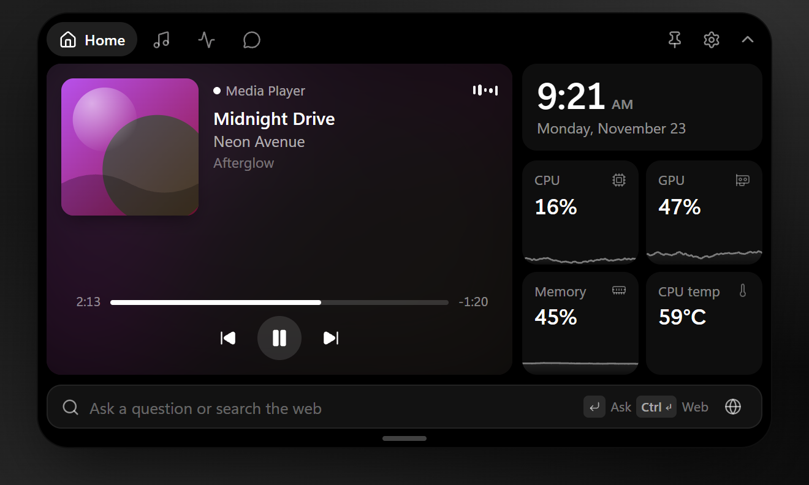
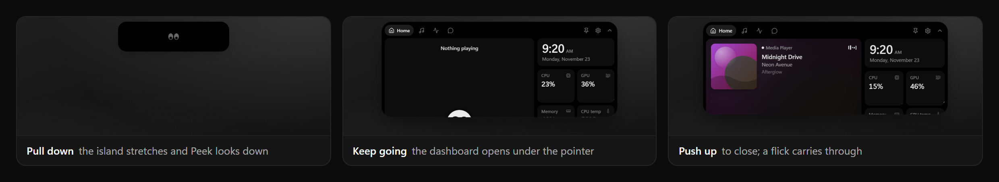
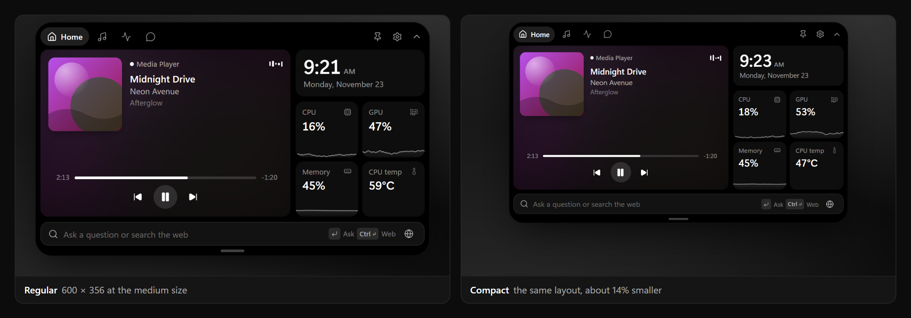
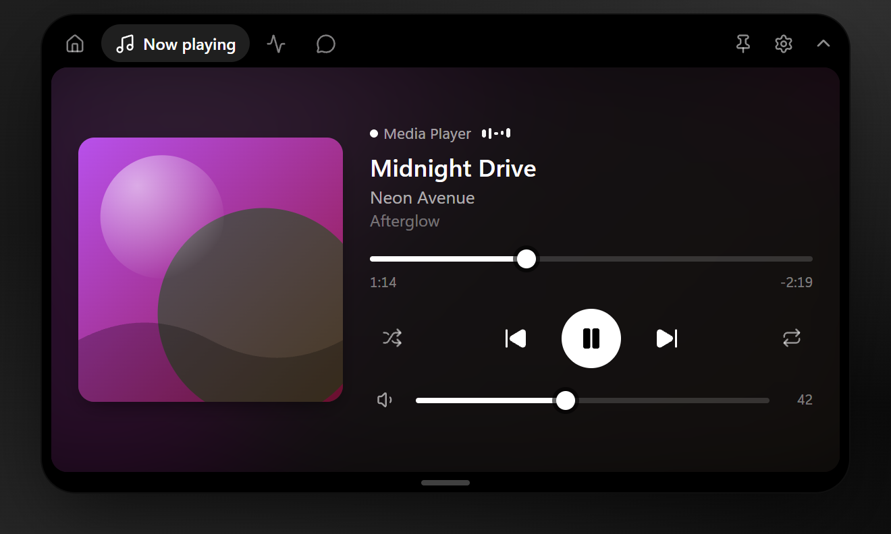
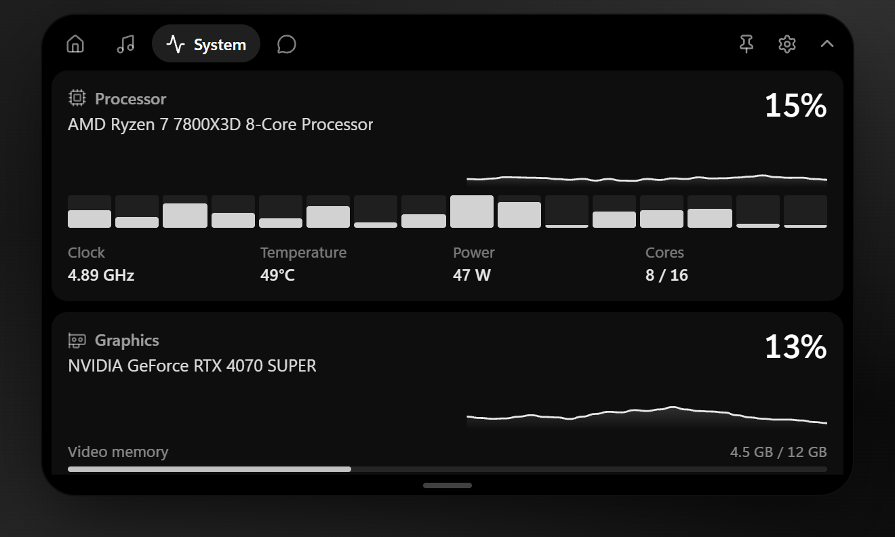
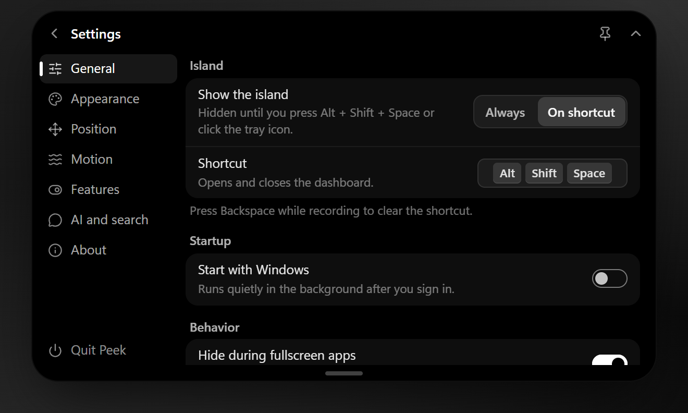

<div align="center">


# Peek

**A Dynamic Island for Windows 11.**

A small island sits at the top of your screen. Pull it down for what's playing,<br />
live hardware stats and an AI search bar, then push it back up.

[](https://github.com/HighSkai/Peek/releases/latest)
[](https://github.com/HighSkai/Peek/releases)
[](https://github.com/HighSkai/Peek/actions/workflows/ci.yml)
[](LICENSE)
[](#requirements)

[**Download**](https://github.com/HighSkai/Peek/releases/latest) &nbsp;·&nbsp; [Features](#features) &nbsp;·&nbsp; [What's new](#whats-new-in-020) &nbsp;·&nbsp; [Getting started](#getting-started) &nbsp;·&nbsp; [AI setup](#ai-setup) &nbsp;·&nbsp; [Build from source](#building-from-source)

<br />



</div>

## What's new in 0.2.0

- Everything is smaller. The dashboard went from 700 × 430 to 600 × 356 at the default size, and the resting island from 182 × 34 to 150 × 31.
- A compact density draws the island and dashboard about 14% smaller again, for people who want it out of the way.
- Hotkey mode keeps the island out of sight until you press the shortcut or click the tray icon.
- Settings open inside the island instead of in a separate window.
- The island follows your pointer when you drag it, in both directions, and a flick carries its speed into the spring.
- Peek's eyes are real eyes now, with pupils that blink, look around and follow the pointer.
- Text uses the Windows 11 fonts: Segoe UI Variable in its Small, Text and Display sizes.
- A cleanup pass removed decoration that didn't do a job, and an optional *Plain answers* mode keeps AI replies free of chatbot filler. See [Design notes](#design-notes).

## Features

### The island

Two looks: *Dynamic Island* floats as a pill just below the top edge, and *Notch* grows out of the screen edge with curved shoulders. When nothing is going on the island shows Peek's eyes, a clock or live stats. While music plays it shows the album art and a visualizer, with a short banner when the track changes.

<div align="center">

</div>

Everything outside the island is click-through. It hides during fullscreen games and videos, and it gives focus back to the app you were using when it closes.

### Drag it open, push it closed

Pull the island down and the dashboard opens under the pointer. Push the open dashboard up by its header or the handle at the bottom and it shrinks back into the island. Let go and Peek uses the pointer's speed: a quick flick finishes the motion, a slow drag that hasn't gone far springs back. Pulling past fully open stretches it a little, like a rubber band. You can also click the island, scroll down on it, or press the shortcut.

<div align="center">

</div>

### Regular or compact

Pick a density in Settings → Appearance. Compact is the same layout drawn about 14% smaller, with crisp text (it uses CSS zoom, not a scaled bitmap). Island and dashboard sizes (small, medium, large) still apply on top.

<div align="center">

</div>

### Hotkey mode

Set *Show the island* to *On shortcut* in Settings → General (or tick *Show only on shortcut* in the tray menu). The island then stays tucked above the top edge of the screen. Press the shortcut, <kbd>Alt</kbd>+<kbd>Shift</kbd>+<kbd>Space</kbd> by default, and it slides down and opens; close it and it slides away again. It also opens over fullscreen apps.

### Now playing

Works with anything that reports media to Windows: Spotify, Chrome, Edge, Firefox, Media Player, Apple Music, TIDAL, VLC and more. Album art, a seek bar, play and pause, next, previous, shuffle, repeat and system volume.

### Hardware monitor

| | Source | Needs anything extra? |
| --- | --- | --- |
| CPU usage, per-thread load, clock | Windows / `sysinfo` | No |
| GPU usage and video memory (NVIDIA, AMD, Intel) | Windows performance counters + DXGI | No |
| NVIDIA temperature, fan, power, clock | NVML (ships with the NVIDIA driver) | No |
| Memory, page file, disks, network, battery, uptime | Windows / `sysinfo` | No |
| CPU and motherboard temperatures, fan RPM, AMD/Intel GPU sensors | [LibreHardwareMonitor](https://github.com/LibreHardwareMonitor/LibreHardwareMonitor) or OpenHardwareMonitor | Keep it running in the background |

Windows doesn't give regular apps CPU temperatures or fan speeds, so Peek reads them from LibreHardwareMonitor when it's running. Sampling only happens while the dashboard is open or live stats are showing.

### AI search bar

Ask a question and the answer streams in, formatted with Markdown. Press <kbd>Ctrl</kbd>+<kbd>Enter</kbd> to search the web in your browser instead. Peek works with local models ([Ollama](https://ollama.com), [LM Studio](https://lmstudio.ai) or any OpenAI-compatible server such as llama.cpp, Jan, LocalAI or vLLM) and with OpenAI, Anthropic, Google Gemini, OpenRouter and Groq. It can search first with [SearXNG](https://docs.searxng.org), Brave Search or Tavily so answers cite numbered sources. API keys are stored in Windows Credential Manager, never in a settings file.

<table>
  <tr>
    <td width="33%"></td>
    <td width="33%"></td>
    <td width="33%"></td>
  </tr>
  <tr>
    <td align="center"><sub>Now playing</sub></td>
    <td align="center"><sub>System</sub></td>
    <td align="center"><sub>Ask</sub></td>
  </tr>
</table>

### Settings, inside the island

The gear in the dashboard opens settings in place, laid out like the Windows 11 Settings app. It covers appearance, density and size, position and monitor, motion (speed, bounce, hover), startup, hotkey mode and the shortcut, every feature toggle, and AI providers. Turn off anything you don't use and it stops running in the background. *Settings…* in the tray menu opens the same page.

<table>
  <tr>
    <td width="50%"></td>
    <td width="50%"></td>
  </tr>
  <tr>
    <td align="center"><sub>Appearance and density</sub></td>
    <td align="center"><sub>Hotkey mode and the shortcut</sub></td>
  </tr>
</table>

<sub>Screenshots use sample data.</sub>

## Getting started

### Requirements

- Windows 10 (version 1903 or later) or Windows 11. Peek is designed for Windows 11.
- Microsoft Edge WebView2 Runtime. It's built into Windows 11; the installer downloads it if needed.

### Install

1. Download **`Peek_x.y.z_x64-setup.exe`** from the [latest release](https://github.com/HighSkai/Peek/releases/latest). An `.msi` is there too.
2. Run it. No admin rights are needed.
3. If SmartScreen warns that the app is unrecognized (the installer isn't code-signed yet), choose **More info → Run anyway**.

Peek appears at the top of your screen and adds an icon to the system tray. Right-click the tray icon for the menu, or open settings from the gear in the dashboard.

### Controls

| Do this | To |
| --- | --- |
| Click the island, pull it down, or scroll down on it | Open the dashboard |
| <kbd>Alt</kbd>+<kbd>Shift</kbd>+<kbd>Space</kbd> (changeable) | Open or close the dashboard with the search bar focused |
| Push the header or the bottom handle up, or tap the handle | Close the dashboard |
| <kbd>Esc</kbd> or click elsewhere | Close the dashboard |
| <kbd>Enter</kbd> in the search bar | Ask the AI (or search the web, if you swap them in settings) |
| <kbd>Ctrl</kbd>+<kbd>Enter</kbd> | Do the other one |
| Pin button in the dashboard | Keep it open while you work in other windows |
| Left-click the tray icon | Open or close the dashboard |

## AI setup

Open Settings → AI and search, pick a provider and press **Load models** to check the connection.

| Provider | Endpoint (default) | Key |
| --- | --- | --- |
| Ollama | `http://127.0.0.1:11434` | Not needed. Run `ollama pull llama3.2` first. |
| LM Studio | `http://127.0.0.1:1234/v1` | Not needed. Start the local server in LM Studio. |
| Custom (OpenAI-compatible) | `http://127.0.0.1:8080/v1` | Optional |
| OpenAI | `https://api.openai.com/v1` | Required |
| Anthropic | `https://api.anthropic.com/v1` | Required |
| Google Gemini | `https://generativelanguage.googleapis.com/v1beta` | Required |
| OpenRouter | `https://openrouter.ai/api/v1` | Required |
| Groq | `https://api.groq.com/openai/v1` | Required |

Every endpoint can be changed, so self-hosted and proxy setups work too. For web answers, choose SearXNG (your instance must allow JSON output), Brave Search or Tavily under *Web answers*, then switch on **Web** in the Ask tab.

*Plain answers* is on by default. It adds a short style guide to the system prompt so replies lead with the answer and skip filler like "Great question!", closing offers, em dashes and inflated words. The rules are condensed from [blader/humanizer](https://github.com/blader/humanizer), which is based on Wikipedia's [Signs of AI writing](https://en.wikipedia.org/wiki/Wikipedia:Signs_of_AI_writing). Turn it off in Settings → AI and search if you prefer your own instructions.

## Privacy

Peek has no accounts, analytics or telemetry. It only talks to the network when you ask it to:

- the AI and search providers you configure, with the questions you send them;
- your browser's search engine when you search the web;
- GitHub, when you press **Check for updates**.

Settings are saved in `%APPDATA%\io.github.highskai.peek`. API keys are saved in Windows Credential Manager under **Peek**. Local models keep everything on your PC.

## Design notes

Peek aims to look like part of Windows rather than a web page.

- Type is Segoe UI Variable, the Windows 11 UI font, in its three optical sizes: Small for captions, Text for body copy and Display for big numbers like the clock. Code uses Cascadia Mono.
- Labels and headings are in sentence case. There are two corner radii (cards and controls) and one shadow (album art).
- The pull-down gesture is direct manipulation: the island's size is driven by the pointer, then handed to a spring with the pointer's velocity. Content fades and scales with how far open the island is, so it never pops in.
- A pass with the [zero-slop / no-slop](https://github.com/eid0lon/zero-slop) pattern catalog removed common tells of generated interfaces: uppercase tracked micro-labels, cards nested in cards, glow and shimmer effects, generic sparkle icons, suggested-prompt chips and em dashes in copy.

## Building from source

You need [Node.js](https://nodejs.org) 20+, [Rust](https://rustup.rs) (stable, MSVC) and the [Tauri prerequisites](https://v2.tauri.app/start/prerequisites/) for Windows.

```powershell
git clone https://github.com/HighSkai/Peek.git
cd Peek
npm install
npm run tauri dev      # run with hot reload
npm run tauri build    # installers land in src-tauri/target/release/bundle
```

`npm run dev` on its own serves the UI in a browser with a demo backend, which is handy for design work. See [CONTRIBUTING.md](CONTRIBUTING.md) for the query parameters it understands.

### Project structure

```
Peek/
├─ src/                     React + TypeScript UI
│  ├─ island/               the island, the gestures, the dashboard and its tabs
│  ├─ settings/             settings pages shown inside the island
│  ├─ components/           Peek's eyes and mascot, shadcn/ui components
│  └─ lib/                  IPC, stores, layout sizes, types, demo backend
├─ src-tauri/               Rust backend (Tauri 2)
│  └─ src/
│     ├─ island.rs          placement, click-through, fullscreen detection, focus
│     ├─ media.rs           Windows media session (GSMTC) integration
│     ├─ audio.rs           output level meter and master volume
│     ├─ hardware/          sysinfo, GPU counters, NVML, LibreHardwareMonitor
│     ├─ ai.rs              streaming chat, model lists, web grounding, plain answers
│     ├─ settings.rs        persisted settings
│     ├─ secrets.rs         Windows Credential Manager
│     └─ tray.rs            tray icon and menu
└─ docs/assets/             logo and screenshots
```

### Built with

[Tauri 2](https://tauri.app) · [React](https://react.dev) · [shadcn/ui](https://ui.shadcn.com) · [Radix UI](https://www.radix-ui.com) · [Tailwind CSS](https://tailwindcss.com) · [Motion](https://motion.dev) · [Lucide](https://lucide.dev) · [sysinfo](https://github.com/GuillaumeGomez/sysinfo) · [windows-rs](https://github.com/microsoft/windows-rs) · [nvml-wrapper](https://github.com/rust-nvml/nvml-wrapper)

Design and writing checks: [zero-slop](https://github.com/eid0lon/zero-slop) · [humanizer](https://github.com/blader/humanizer)

## Contributing

Issues and pull requests are welcome. Please read [CONTRIBUTING.md](CONTRIBUTING.md) first.

## License

[MIT](LICENSE)

<sub>Inspired by the Dynamic Island on iPhone. Apple, iPhone and Dynamic Island are trademarks of Apple Inc.; Peek is an independent project and is not affiliated with Apple.</sub>
