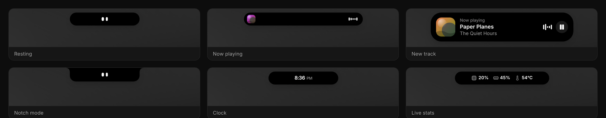
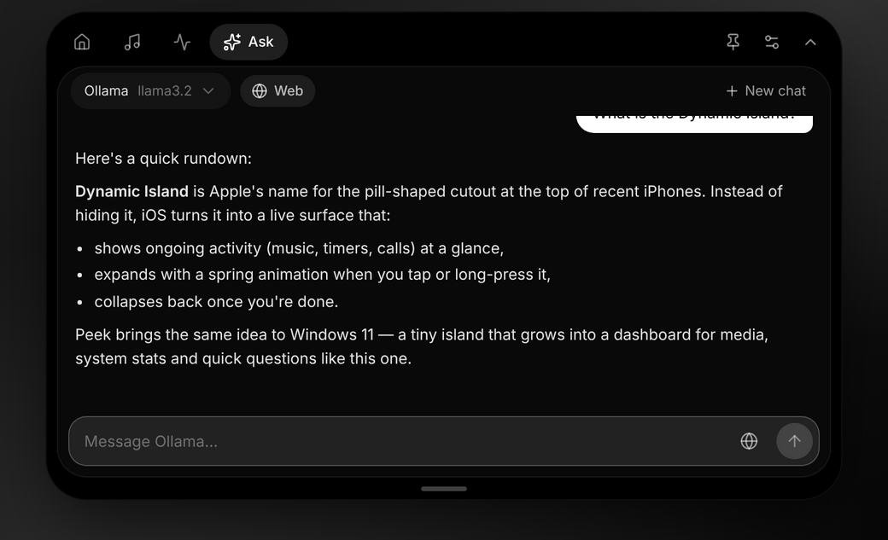
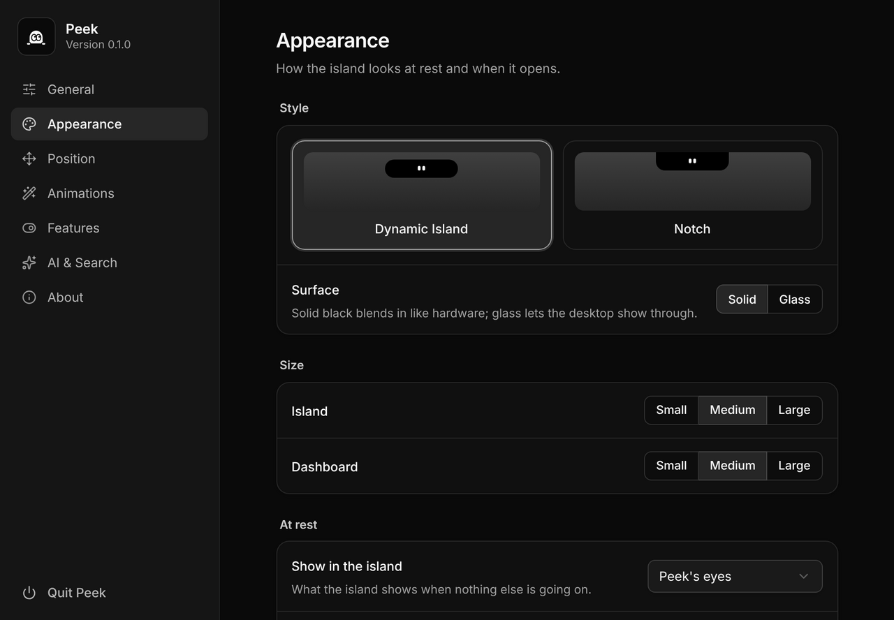

<div align="center">


# Peek

**A Dynamic Island for Windows 11.**

A tiny island lives at the top of your screen. Pull it down for what's playing,<br />
live hardware stats and an AI search bar, then flick it away.

[](https://github.com/HighSkai/Peek/releases/latest)
[](https://github.com/HighSkai/Peek/releases)
[](https://github.com/HighSkai/Peek/actions/workflows/ci.yml)
[](LICENSE)
[](#requirements)

[**Download**](https://github.com/HighSkai/Peek/releases/latest) &nbsp;·&nbsp; [Features](#features) &nbsp;·&nbsp; [Getting started](#getting-started) &nbsp;·&nbsp; [AI setup](#ai-setup) &nbsp;·&nbsp; [Build from source](#building-from-source)

<br />


</div>

## Features

### The island

- **Two looks.** *Dynamic Island* floats as a pill just below the top edge; *Notch* grows out of the screen edge like a laptop notch, with curved shoulders.
- **Live activities.** Album art and an audio-reactive visualizer while music plays, a banner when the track changes, and Peek's little eyes, a clock or live stats when nothing is going on.
- **Pull it down.** Click, drag down, or scroll on the island and it springs open into a full dashboard. Press <kbd>Esc</kbd>, click anywhere else, or tap the handle to close it.
- **Out of your way.** Everything outside the island is click-through, it hides itself during fullscreen games and videos, and it hands focus back to the app you were using.

<div align="center">

</div>

### Now playing

Works with anything that reports media to Windows: Spotify, Chrome, Edge, Firefox, Media Player, Apple Music, TIDAL, VLC and more. Album art, a seek bar, play/pause, next, previous, shuffle, repeat and system volume, all in one place.

### Hardware monitor

| | Source | Needs anything extra? |
| --- | --- | --- |
| CPU usage, per-thread load, clock | Windows / `sysinfo` | No |
| GPU usage and video memory (NVIDIA, AMD, Intel) | Windows performance counters + DXGI | No |
| NVIDIA temperature, fan, power, clock | NVML (ships with the NVIDIA driver) | No |
| Memory, page file, disks, network, battery, uptime | Windows / `sysinfo` | No |
| CPU and motherboard temperatures, fan RPM, AMD/Intel GPU sensors | [LibreHardwareMonitor](https://github.com/LibreHardwareMonitor/LibreHardwareMonitor) or OpenHardwareMonitor | Keep it running in the background |

Windows doesn't give regular apps access to CPU temperature or fan sensors, so Peek reads them from LibreHardwareMonitor when it's running and picks it up automatically. Sampling only happens while the dashboard is open.

### AI search bar

- Ask a question and the answer streams in, formatted with Markdown. Press <kbd>Ctrl</kbd>+<kbd>Enter</kbd> to search the web in your browser instead.
- **Local models:** [Ollama](https://ollama.com), [LM Studio](https://lmstudio.ai) or any OpenAI-compatible server (llama.cpp, Jan, LocalAI, vLLM).
- **Cloud providers:** OpenAI, Anthropic, Google Gemini, OpenRouter and Groq.
- **Web answers:** optionally search first with [SearXNG](https://docs.searxng.org), Brave Search or Tavily, and the model answers with numbered sources you can open.
- API keys are stored in Windows Credential Manager, never in a settings file.

<table>
  <tr>
    <td width="33%"></td>
    <td width="33%"></td>
    <td width="33%"></td>
  </tr>
  <tr>
    <td align="center"><sub>Now Playing</sub></td>
    <td align="center"><sub>System</sub></td>
    <td align="center"><sub>Ask</sub></td>
  </tr>
</table>

### Make it yours

A native settings window (with Mica on Windows 11) covers appearance, size, position, monitor, animation speed and bounce, startup behavior, the global shortcut and every feature toggle. Turn off anything you don't use and it stops running in the background.

<div align="center">

</div>

<sub>Screenshots use sample data.</sub>

## Getting started

### Requirements

- Windows 10 (version 1903 or later) or Windows 11. Peek is designed for Windows 11.
- Microsoft Edge WebView2 Runtime. It's built into Windows 11; the installer downloads it if needed.

### Install

1. Download **`Peek_x.y.z_x64-setup.exe`** from the [latest release](https://github.com/HighSkai/Peek/releases/latest). An `.msi` is there too.
2. Run it. No admin rights are needed.
3. If SmartScreen warns that the app is unrecognized (the installer isn't code-signed yet), choose **More info → Run anyway**.

Peek appears at the top of your screen and adds an icon to the system tray. Right-click the tray icon for the menu, or open **Settings** from the dashboard.

### Controls

| Do this | To |
| --- | --- |
| Click the island, drag it down, or scroll down on it | Open the dashboard |
| <kbd>Alt</kbd>+<kbd>Shift</kbd>+<kbd>Space</kbd> (changeable) | Open the dashboard with the search bar focused |
| <kbd>Enter</kbd> in the search bar | Ask the AI (or search the web, if you swap them in settings) |
| <kbd>Ctrl</kbd>+<kbd>Enter</kbd> | Do the other one |
| <kbd>Esc</kbd>, click elsewhere, or tap the handle | Close the dashboard |
| Pin button in the dashboard | Keep it open while you work in other windows |
| Left-click the tray icon | Toggle the dashboard |

## AI setup

Open **Settings → AI & Search**, pick a provider and press **Load models** to check the connection.

| Provider | Endpoint (default) | Key |
| --- | --- | --- |
| Ollama | `http://127.0.0.1:11434` | Not needed. Run `ollama pull llama3.2` first. |
| LM Studio | `http://127.0.0.1:1234/v1` | Not needed. Start the local server in LM Studio. |
| Custom (OpenAI-compatible) | `http://127.0.0.1:8080/v1` | Optional |
| OpenAI | `https://api.openai.com/v1` | Required |
| Anthropic | `https://api.anthropic.com/v1` | Required |
| Google Gemini | `https://generativelanguage.googleapis.com/v1beta` | Required |
| OpenRouter | `https://openrouter.ai/api/v1` | Required |
| Groq | `https://api.groq.com/openai/v1` | Required |

Every endpoint can be changed, so self-hosted and proxy setups work too. For web answers, choose SearXNG (your instance must allow JSON output), Brave Search or Tavily under **Web answers**, then toggle **Web** in the Ask tab.

## Privacy

Peek has no accounts, analytics or telemetry. It only talks to the network when you ask it to:

- the AI and search providers you configure, with the questions you send them;
- your browser's search engine when you search the web;
- GitHub, when you press **Check for updates**.

Settings are saved in `%APPDATA%\io.github.highskai.peek`. API keys are saved in Windows Credential Manager under **Peek**. Local models keep everything on your PC.

## Building from source

You need [Node.js](https://nodejs.org) 20+, [Rust](https://rustup.rs) (stable, MSVC) and the [Tauri prerequisites](https://v2.tauri.app/start/prerequisites/) for Windows.

```powershell
git clone https://github.com/HighSkai/Peek.git
cd Peek
npm install
npm run tauri dev      # run with hot reload
npm run tauri build    # installers land in src-tauri/target/release/bundle
```

`npm run dev` on its own serves the UI in a browser with a demo backend, which is handy for design work. See [CONTRIBUTING.md](CONTRIBUTING.md) for details.

### Project structure

```
Peek/
├─ src/                     React + TypeScript UI
│  ├─ island/               the island, dashboard and its tabs
│  ├─ settings/             settings window
│  ├─ components/ui/        shadcn/ui components
│  └─ lib/                  IPC, stores, types, demo backend
├─ src-tauri/               Rust backend (Tauri 2)
│  └─ src/
│     ├─ island.rs          placement, click-through, fullscreen detection, focus
│     ├─ media.rs           Windows media session (GSMTC) integration
│     ├─ audio.rs           output level meter and master volume
│     ├─ hardware/          sysinfo, GPU counters, NVML, LibreHardwareMonitor
│     ├─ ai.rs              streaming chat, model lists, web grounding
│     ├─ settings.rs        persisted settings
│     ├─ secrets.rs         Windows Credential Manager
│     └─ tray.rs            tray icon and menu
└─ docs/assets/             logo and screenshots
```

### Built with

[Tauri 2](https://tauri.app) · [React](https://react.dev) · [shadcn/ui](https://ui.shadcn.com) · [Radix UI](https://www.radix-ui.com) · [Tailwind CSS](https://tailwindcss.com) · [Motion](https://motion.dev) · [Lucide](https://lucide.dev) · [sysinfo](https://github.com/GuillaumeGomez/sysinfo) · [windows-rs](https://github.com/microsoft/windows-rs) · [nvml-wrapper](https://github.com/rust-nvml/nvml-wrapper)

## Contributing

Issues and pull requests are welcome. Please read [CONTRIBUTING.md](CONTRIBUTING.md) first.

## License

[MIT](LICENSE)

<sub>Inspired by the Dynamic Island on iPhone. Apple, iPhone and Dynamic Island are trademarks of Apple Inc.; Peek is an independent project and is not affiliated with Apple.</sub>
